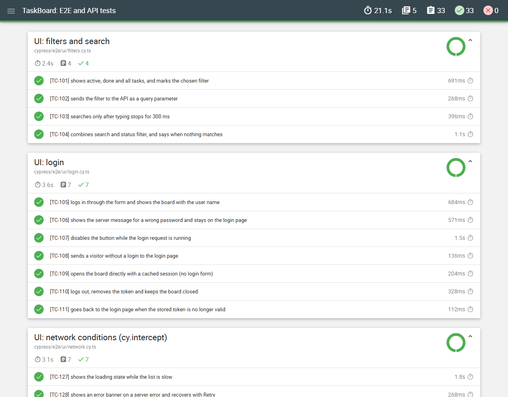
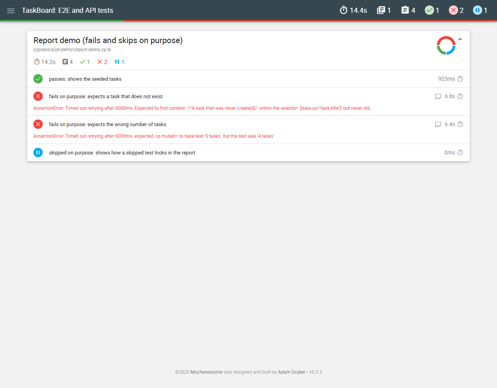
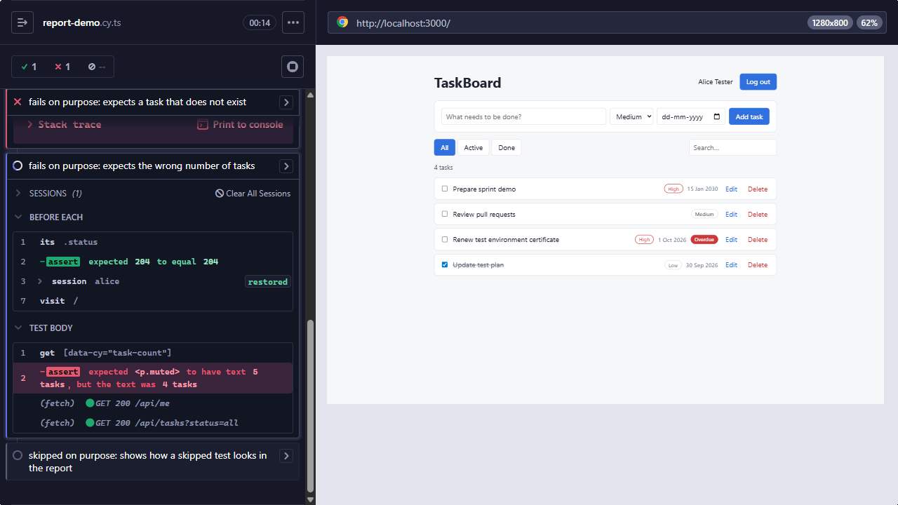
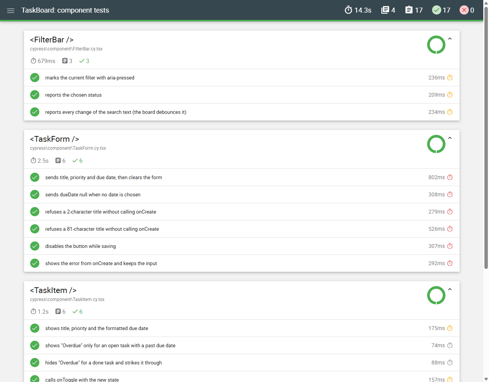

# Cypress TypeScript Framework

[](https://github.com/niranjankagri/cypress-typescript-framework/actions/workflows/ci.yml)

Cypress 16 + TypeScript test framework for **TaskBoard**, a small React + Node task app that lives in this
repository. Three kinds of tests run against it:

| Kind          | Where                  | Tests | What they check                                                      |
| ------------- | ---------------------- | ----: | -------------------------------------------------------------------- |
| API           | `cypress/e2e/api`      |    31 | status codes, zod contracts, validation rules, access to other users |
| UI end-to-end | `cypress/e2e/ui`       |    33 | user flows in the browser, network conditions, time-dependent UI     |
| Component     | `cypress/component`    |    17 | React components mounted alone, callbacks recorded with `cy.stub()`  |
| App unit/HTTP | `app/server/*.test.ts` |    15 | the server's own rules (`node:test`, no Cypress)                     |
| Report demo   | `cypress/e2e/demo`     |     4 | pass, fail and skip **on purpose**, to show the report; not in CI    |

**81 Cypress tests**, green in CI on Chrome, Firefox and Edge.

The app is part of the repo on purpose: CI never breaks because a public demo site changed, added a bot
check or went down, and the tests can use what Cypress is best at: controlling the network
(`cy.intercept`), the clock (`cy.clock`), the login (`cy.session`) and mounting components.

## What it shows

- **API tests with `cy.request`** through a typed client; every call yields the full response, so 4xx
  answers are tested as easily as 2xx ones.
- **Contract tests with zod** (`strictObject`): an extra field fails the test with its name. Checked by
  leaking the server's `ownerId` on purpose: `Unrecognized key: "ownerId"`.
- **Data-driven tests and boundary values**: login bodies, 2/3/80/81-character titles, impossible dates.
- **Page objects** for the UI (`cypress/pages`), with a task row found by its exact title.
- **`cy.session` login** cached across specs, with a `validate()` step that logs in again when the token
  was revoked (for example by the logout test).
- **`cy.intercept`**: slow answers (loading state), server errors and Retry, a network failure, a fully
  stubbed list from a fixture, a server validation message, an expired login, request body and header
  checks, and "no request was sent" checks (`cy.get('@alias.all')`).
- **`cy.clock` / `cy.tick`**: the "Overdue" badge on, before and after the due date; a 300 ms search
  debounce (no request at 299 ms, one at 300 ms); a toast that hides after exactly 3 s.
- **`window:confirm`** accepted and cancelled.
- **Component tests** (`cy.mount`) for the form, the task row, the filter bar and the toast.
- **Cypress 16 configuration values**: the password is a secret in `env`, read with `cy.env()` (it is
  never bundled into the browser code); public switches go in `expose`.
- **Test isolation**: every test resets the server data (`POST /api/test/reset`) and creates its own data
  through the API.
- **HTML report** (mochawesome) with failure screenshots embedded; **GitHub Actions** with lint, typecheck,
  API, UI in three browsers and component jobs.

## Tech stack

| Area    | Tools                                                                    |
| ------- | ------------------------------------------------------------------------ |
| Tests   | Cypress 16.2, TypeScript 6.0, zod 4, cypress-mochawesome-reporter        |
| App     | React 19 + Vite 8 (web), Node 24 built-ins only (API, run as TypeScript) |
| Quality | ESLint 10 (type-aware, eslint-plugin-cypress), Prettier                  |
| CI      | GitHub Actions, cypress-io/github-action                                 |

## Project structure

```
app/
  server/            TaskBoard API (Node, no dependencies): server.ts, store.ts (rules), seed.ts
                     + store.test.ts / server.test.ts (node:test)
  web/               React UI: pages (Login, Board), components (TaskForm, TaskItem, FilterBar, Toast)
cypress/
  e2e/api/           auth, tasks, validation
  e2e/ui/            login, tasks, filters, network (cy.intercept), time (cy.clock)
  e2e/demo/          report demo (fails and skips on purpose; npm run cy:demo)
  component/         TaskItem, TaskForm, FilterBar, Toast (*.cy.tsx)
  pages/             page objects: LoginPage, BoardPage
  fixtures/          tasks.json (stubbed list)
  support/
    api.ts           typed API client on cy.request
    schemas.ts       zod contracts + expectSchema()
    commands.ts      getBySel, resetData, apiToken, loginAs (cy.session), createTask
    data.ts          seeded users and tasks, buildTask()
    e2e.ts           loaded before every e2e spec
    component.ts     cy.mount + styles, loaded before every component spec
cypress.config.ts    e2e + component projects, reporter, retries, env / expose
.github/workflows/   ci.yml
docs/                framework-design.md, interview guide, images
```

## The app under test

TaskBoard: log in, add tasks with a priority and an optional due date, mark them done, rename them in
place, delete them (with a confirmation), filter by status and search.

| Endpoint                          | Notes                                                      |
| --------------------------------- | ---------------------------------------------------------- |
| `POST /api/login`                 | 200 token + user; 401 wrong credentials; 400 missing field |
| `POST /api/logout`, `GET /api/me` | Bearer token                                               |
| `GET /api/tasks?status=&q=`       | own tasks, newest first; status `all`/`active`/`done`      |
| `POST /api/tasks`                 | 201; 400 with `{ error, field }` for each broken rule      |
| `GET/PATCH/DELETE /api/tasks/:id` | another user's task answers 404                            |
| `POST /api/test/reset`            | test hook: seed data back (off with `TEST_HOOKS=off`)      |

Demo users: `alice` (4 tasks), `bob` (1), `carol` (none), password `Password1!`.

**Why the app is in this repository:** the tests run against their own copy, started fresh for every run, locally and in
CI. No shared or hosted environment means no outages, no test data shared between runs, and no change somewhere else
that breaks these tests; one clone and one command run everything. It is also built for this framework: a reset endpoint
gives every test clean data.

## How a test runs

1. `beforeEach`: `cy.resetData()` puts the seed data back, so every test starts from the same state.
2. UI tests call `cy.loginAs('alice')`: the first time, `cy.session` logs in through the API and stores the
   token in localStorage; later tests and specs restore it after `validate()` checked it with `/api/me`.
3. Setup data goes through the API (`cy.createTask`), not through the UI: fast and independent of the
   screens the test is not about.
4. The test works through the page objects and asserts with Cypress's retrying assertions; network and
   time are controlled with `cy.intercept` and `cy.clock` where the test needs it.
5. On failure Cypress takes a screenshot; the reporter embeds it in the HTML report.

## Run it

Needs Node 24. Cypress downloads its binary on `npm ci`.

```bash
npm ci
npm test                 # build the app, start it, run all API + UI tests, stop it
```

Other commands (the app must be running for the e2e ones: `npm run build` once, then `npm start`):

```bash
npm run cy:open          # Cypress UI: pick specs, watch them run, time-travel through commands
npm run cy:api           # API specs only
npm run cy:ui            # UI specs only
npx cypress run --browser chrome   # or firefox / edge
npm run cy:component     # component tests (no server needed)
npm run cy:demo          # report demo: 1 pass, 2 fail, 1 skip on purpose
npm run test:app         # the app's own node:test tests
npm run lint             # ESLint + Prettier
npm run typecheck        # app and tests
npm run dev              # app with hot reload on :5173 (API still on :3000 via npm start)
```

`CYPRESS_PASSWORD=...` overrides the demo password; `CYPRESS_VIDEO=true` records videos.

## Reports

Each run writes one HTML report: `cypress/reports/e2e/index.html` or `cypress/reports/component/index.html`.

All API and UI tests passed (64 tests, 8 specs):



Report demo: a pass, two failures with their messages, and a skipped test:



The failure screenshot of one demo test: the Cypress runner shows the restored session, the failed
assertion ("expected 5 tasks, but the text was 4 tasks") and the board at that moment:



Component tests (17):



## CI

`.github/workflows/ci.yml` runs on every push and pull request to `main`, by hand and every night:

1. **Lint, typecheck, app tests**: ESLint, Prettier, `tsc` for app and tests, `node:test` (no Cypress
   binary needed).
2. In parallel after that: **API tests**, **UI tests** in Chrome, Firefox and Edge, **component tests**.
   `cypress-io/github-action` builds and starts the app, waits for `/api/health` and writes a job summary.
3. Each job uploads its HTML report, also when tests fail.

## Design notes

- **`data-cy` selectors** everywhere: they do not change when styles or texts change.
- **No fixed waits**: `cy.wait(<ms>)` is a lint error; tests wait on aliases or on retrying assertions.
- **`clear()` and `type()` in separate chains** (`fill()` in the page objects): React may re-render the
  field after `clear()`, and a new query always finds the current element.
- **One retry in `cypress run`**, none in `cypress open`: CI survives a single hiccup, local runs show
  flakiness.
- **Another user's task answers 404, not 403**, and a wrong user and a wrong password get the same
  message: the API does not reveal what exists. Both are tested.

More: [docs/framework-design.md](docs/framework-design.md).

## Known limitations

- The app keeps its data in memory; a restart (or `/api/test/reset`) brings back the seed data.
- Specs run one after another against one server; parallel runs would need a server (or data set) per
  worker. In CI, browsers run in parallel jobs, each with its own server.
- No visual or accessibility checks yet (planned as a separate project).
- WebKit is not covered (Cypress support for it is experimental).

## License

MIT
